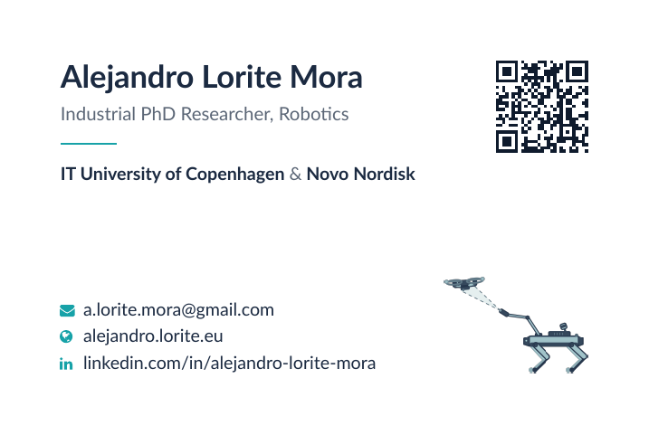

# Business card: Alejandro Lorite Mora

My business card as code: one HTML file with CSS in millimeters, printed to a print-ready PDF by headless Chrome.



- European size, 85 × 55 mm, one-sided, white background, so any office printer or print shop can print it.
- The drawing of the Spot quadruped and the Crazyflie drone comes from the stick-scene props of my (private) Slidev presentation theme, recolored in the two tones of the card.
- The QR code opens [alejandro.lorite.eu](https://alejandro.lorite.eu).

## Download

GitHub Actions builds the card on every push to `main` (`.github/workflows/build-card.yml`) and publishes it to the rolling `card-latest` release. These public files have no phone line:

- [Alejandro-Lorite-Mora-business-card-print.pdf](https://github.com/Lorite/lorite-business-card/releases/download/card-latest/Alejandro-Lorite-Mora-business-card-print.pdf): one card with bleed, for a print shop.
- [Alejandro-Lorite-Mora-business-card-a4-sheet.pdf](https://github.com/Lorite/lorite-business-card/releases/download/card-latest/Alejandro-Lorite-Mora-business-card-a4-sheet.pdf): 10 cards on A4 with cut marks.
- [Alejandro-Lorite-Mora.vcf](https://github.com/Lorite/lorite-business-card/releases/download/card-latest/Alejandro-Lorite-Mora.vcf): the same contact details as a vCard, to save them to a phone's contacts in one step. The Contact page of [alejandro.lorite.eu](https://alejandro.lorite.eu/Contact) links to it.

The workflow also checks that the QR code decodes to the website, that the vCard parses, and that neither the PDF nor the vCard contains a phone number. To print cards with the phone number, build locally.

## Build

Requirements: `google-chrome`, `pdfinfo` and `pdftoppm` (poppler-utils), [`uv`](https://docs.astral.sh/uv/), and the fonts Lato and FontAwesome 4 installed on the system (`fonts-lato`, `fonts-font-awesome` on Ubuntu).

```bash
cp private.example.env private.env   # then put the real phone number in private.env
./build.sh
```

`build.sh` writes:

- `business-card-print.pdf`: one card on a 91 × 61 mm page (85 × 55 mm trim plus 3 mm bleed), with TrimBox and BleedBox set, for a print shop.
- `business-card-a4-sheet.pdf`: 10 cards on A4 with cut marks, for an office printer and a paper cutter.
- `preview-1.png`: a 400 dpi preview.
- `Alejandro-Lorite-Mora.vcf`: the vCard, built from `contact.vcf` with CRLF line endings.

### The phone number stays private

The phone number is not in the repository. `card.html` contains the placeholder `+45 00 00 00 00`, and `build.sh` replaces it with `PHONE` from `private.env`, which git ignores. `contact.vcf` uses the same placeholder in its `TEL` line. Without `private.env` (as in GitHub Actions), `build.sh` removes the phone line from both. The local PDFs, previews and vCard are ignored by git, because they contain the real number. `PUBLIC=1 ./build.sh` ignores `private.env` and also writes `docs/preview.png` without the phone line, for this README.

## Print

1. Print `business-card-a4-sheet.pdf` at 100 % scale ("actual size", not "fit to page") on card stock of 250 to 350 g/m².
2. Measure one card (85 × 55 mm) and scan the QR code with a phone before you cut the whole sheet.
3. Cut along the marks with a paper cutter.

All content stays at least 5 mm inside the trim line, so a small cutting error does not show.

## Files

| Path | What it is |
| --- | --- |
| `card.html` | The card: layout, text and CSS. Edit this file to change the card. |
| `contact.vcf` | The vCard template. Keep its details the same as `card.html`. |
| `build.sh`, `finalize.py` | Chrome prints the PDF, then `finalize.py` (pypdf) sets the exact page size, TrimBox and BleedBox, and builds the A4 sheet. |
| `assets/` | QR code and the robot drawing in three styles: `robots-duotone.png` (used), `robots-color.png`, `robots-watermark.png`. |
| `robots-render/` | Renders the robot drawing again from the Slidev theme: `PW=<dir with playwright@1.63.0> robots-render/make.sh`. |
| `layout-variants/` | Alternative layouts I considered: two columns, teal panel, and Spot standing on a hairline. |
| `v1-trading-card/` | The first design, a holographic-style trading card (63 × 88 mm). |

## Credits

The robot drawings use the stick-scene runtime ([nilbuild/stick-scene](https://github.com/nilbuild/stick-scene), MIT, by Kamran Ahmed) with my own `robots.js` props. `robots-render/make.sh` copies both from the Slidev theme at render time, so they are not duplicated here.
